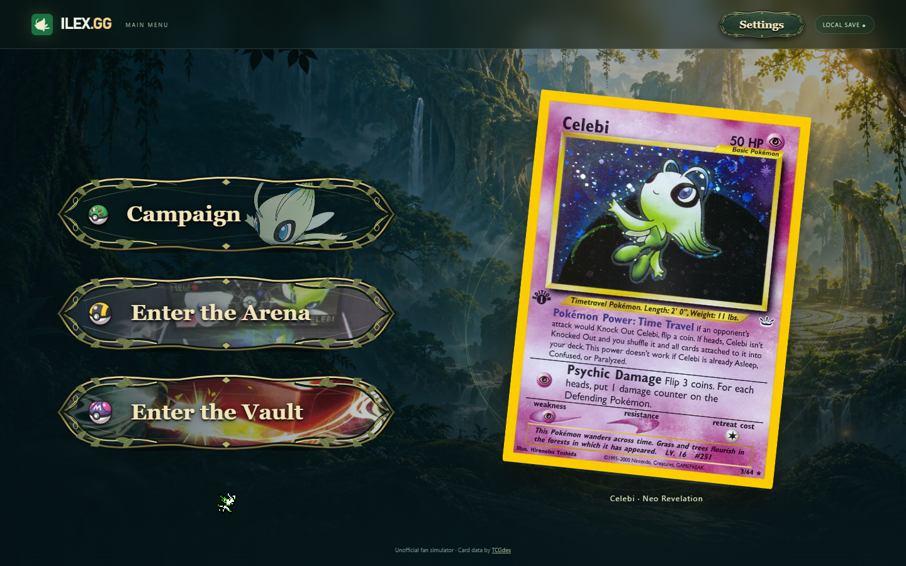
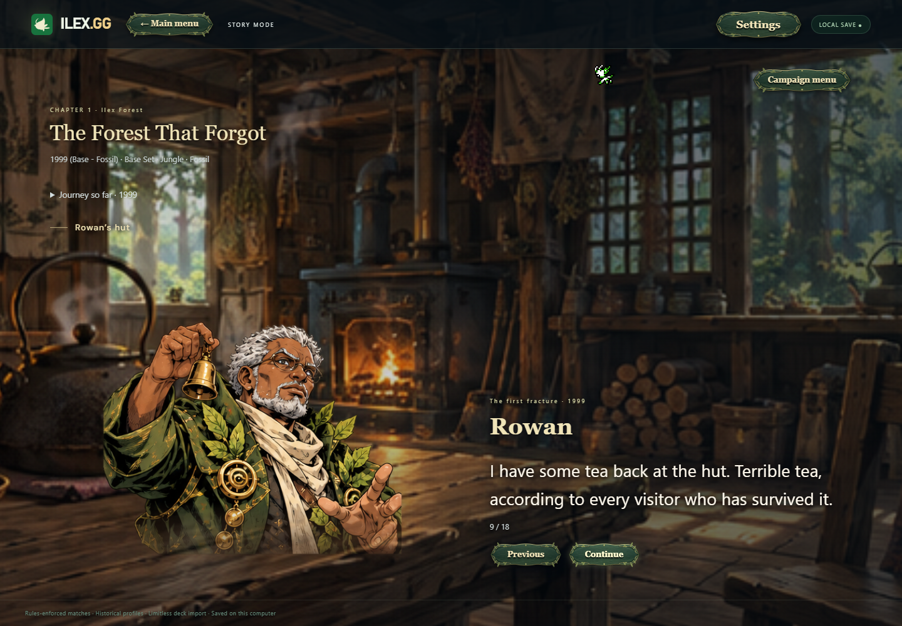
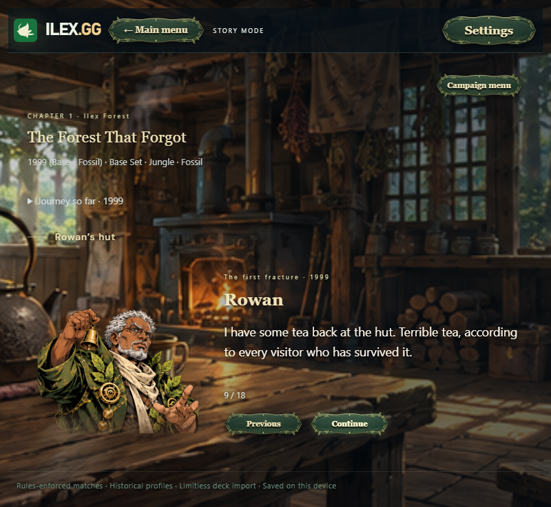
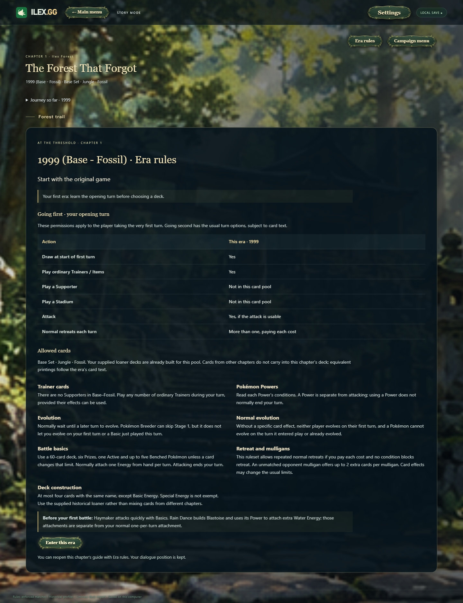

# ILEX.GG

Pokémon TCG simulator for **Windows and Android**, with rules automation, deck building, local/bot play, packs, Cube Drafting, Campaign and two new alternate play modes.

## New in 3.1.0: New Rule and Ken Guy Rules

In **Play**, select your format and decks, then choose **Alternate Mode → New Rule · 96 Cards** or **Ken Guy Rules**. The private-match host has the same selector. These are separate modes; they do not combine. Existing matches retain their saved mode.

### New Rule — a shared 96-card rule deck

- Reveal a shared rule before the first turn and each following turn. Both players can use active rules, with separate per-player usage limits. At five active rules, the incoming player chooses which to replace.
- Shared effects alter the battle with actions, reveal effects, Bench limits, typing, movement, evolution, Energy, Abilities and Prize interactions. Discarded rules recycle separately; active rules and attached Vessel of Life stay out of that shuffle.
- Use the compact shared-rule strip or **Shared Rules** to inspect/use cards; **Rule Deck** shows all 96 supplied scans. Android landscape keeps these controls under **Match controls**.

Read the [New Rule guide](NEW-RULE-MODE.md) for the supplied interpretations and interaction corrections.

### Ken Guy Rules — a different way to play

- Both players open with 13 cards and choose six secret Prizes before choosing their starting Pokémon. The first player may attack **or** play a Supporter, but not both.
- Each player has a separate once-per-game action that ends the opponent's turn after the current effect finishes; it becomes available after both players have completed their first turn.
- A qualifying last-card hand-discard effect triggers **High 5**. Players offer/accept/refuse through native prompts; refusal can end the turn and produce one deterministic penalty, including Prize, next-turn draw/Trainer/Ability restrictions or the 1% immediate-loss result.
- Concede is disabled. A failed required opening draw from an empty deck awards the opponent one Prize, then play continues. Explicit card-win effects such as Unown HAND retain their printed conditions.

Read the [Ken Guy Rules guide](KEN-GUY-RULES.md) for the exact High 5 probabilities, timing and exceptions. Both modes support local/bot play and saved journal replay/Undo. Private Undo requires opponent approval; Multiplayer remains in progress.

### Pocket implementation removed

**Pocket has been removed from the app. ILEX.GG now focuses on the regular Pokémon TCG.** The separate Pocket rules engine, screens, cards, packs, artwork and mixed-in gallery catalogs are no longer included. Legacy migration removes retired Pocket-only workspace data while retaining regular TCG content. Campaign, regular eras, packs, decks, music, image caching and Cube Drafting remain available.

### Other fixes in this build

New Rule corrections cover damaged-Pokémon deck returns under Scoop Up Block, effective Bench capacity for Tandem Unit, current typing for Thunder Mountain and paired Stadiums under Barrier Shrine. Ken Guy corrections cover conditional Rose discard/High 5 timing, rejected-action rollback and paired Stadiums under the Trainer penalty. Existing journals retain recorded outcomes; future actions use the corrections, including corrected new branches after Undo.

**3DS and Multiplayer remain in progress.** Earlier starter-only 3DS Alpha downloads stay available in the [2.0.0 release](https://github.com/KenGuyGames/ILEX.GG/releases/tag/v2.0.0-build-2026-10-23); these alternate modes are not implemented in that native port. Physical Android and external two-PC/different-NAT/full strategic-match acceptance remain pending.

## Campaign retained from 3.0.0: Campaign — The Forest Keeps Growing

Choose **Campaign** directly from the main menu, beside Enter the Arena and Enter the Vault. Start a New Game or Continue your saved journey through **13 chapters**, two paths per chapter and **64 battles per playthrough**.

- **A story across TCG eras:** authored dialogue, companion choices and historical/campaign deck matchups, with 94 used decklists. Campaign variants are identified; these encounters are not claims of official tournament legality.
- **Progress that stays with you:** saved dialogue, path choices, difficulty and active battle journals; Continue, loss/retry and win-gated progression. Campaign progress is separate from regular matches and decks. New Game asks before replacing existing campaign progress; export your workspace before experimenting.
- **Characters and scenery:** 68 human character designs, official Pokémon portraits, 42 scenic environments and responsive dialogue presentation. The expanded script retains stable scene anchors for existing saves.
- **A campaign soundtrack:** 13 chapter dialogue tracks, 13 regular battle tracks and 24 boss/featured tracks. Music follows the current chapter/encounter, with volume/mute and background-pause controls. Text speed and word sounds are in Settings; dialogue uses a text sound effect, not recorded voice acting.
- **Era rules briefings:** explanations of opening-turn rules, evolution, Energy, Prize trades and era mechanics as you enter each chapter; reread Era rules without moving your save cursor.
- **Table presentation fix:** attack portraits now follow the attacking Active and stay inside the visible table on ultrawide and narrow displays.

### Campaign screenshots

**Campaign on the main menu**



**Character dialogue and scenic environments**



**Mobile dialogue layout** — captured with touch emulation.



<details>
<summary>View an era-rules briefing</summary>

Learn the opening-turn rules and mechanics before entering an era.



</details>

## Download 3.1.0

| Platform | Download | Requirements |
| --- | --- | --- |
| Windows | [ILEX.GG-Windows.zip](https://github.com/KenGuyGames/ILEX.GG/releases/download/v3.1.0-build-2026-10-27/ILEX.GG-Windows.zip) | Windows 10/11 64-bit; extract the entire ZIP and run ILEX.GG.exe |
| Android | [ILEX.GG-Android.apk](https://github.com/KenGuyGames/ILEX.GG/releases/download/v3.1.0-build-2026-10-27/ILEX.GG-Android.apk) | Android 8+ and current WebView; **3.1.0-android.111 / code111** |

Windows includes Electron 44.9.3; the EXE is unsigned. Keep the extracted folder together. Android is signed with the original certificate: install over your existing APK to retain workspace/cache; do not uninstall first. Physical Android acceptance remains pending. Windows retains `%APPDATA%\TCG Lab`. Export/import transfers workspace JSON and replaces the destination workspace; there is no automatic cloud sync. Rules, music and included artwork work offline; uncached paper card scans download as viewed with size/hash checks.

[Android installation](verification/ILEX.GG-Android-Install.md) · [Release notes/checksums](https://github.com/KenGuyGames/ILEX.GG/releases/tag/v3.1.0-build-2026-10-27) · [Older releases](https://github.com/KenGuyGames/ILEX.GG/releases/)

## Multiplayer — still in progress

Windows Multiplayer remains experimental/beta. Both peers need the same **3.1.0** build. Real local two-renderer WebRTC/STUN transport was tested in earlier work; independent external two-PC/different-NAT and complete strategic-match acceptance remain pending. There is no TURN fallback; the trusted host can inspect full state. Android networking, campaign co-op, cube networking and public matchmaking are unavailable.

## Verification and limits

The final New Rule interaction audit records66 setup/action cases,25 focused interactions,96 first-rule reveals/replays and26 natural full bot matches with exact replay. Its1,560 rule/action combinations include1,464 eligible executions and96 correctly ineligible fixtures. Ken Guy regressions retain34 core and93 interaction checks. Broad Ability/Stadium surface checks and finite fixtures do not certify every card pair. Reports retain their actual engine hashes and dates; see `verification/alternate-modes/`.

The current campaign reports record chapter/path/deck checks, finite opening-turn gameplay smoke tests, saved dialogue/battle recovery, desktop/native and mobile-emulation checks. The latest main-menu patch passed 56 desktop, 56 mobile and six native checks; earlier campaign soundtrack, art, rules-briefing and portrait-anchor reports retain their actual tested hashes. Progression fixtures that advance through reducer concessions do not establish a complete strategic playthrough. No physical Android acceptance or speaker-listening certification is claimed.

Paper engine SHA-256 is `44ddf4a88877ec76943cba5c6b10a70534a1686bdd03f88843111dc923bbfdd2`. Canonical TypeScript is `work/cube-source/src`. Campaign is a separate layer using existing rules and deck data. See `verification/campaign/`, `verification/ILEX.GG-Android-verification.json`, `verification/desktop-verification-3.1.0.json` and the [3.1.0 fresh-source workflow](https://github.com/KenGuyGames/ILEX.GG/actions/workflows/test-release-3.1.0.yml). Source ZIP/tar.gz and README commands are checked before publication.

## Cube Drafting

Open Enter the Arena → Cube Draft. Draft a custom pool against local bots, resume saved sessions, build from your seat's picks and play local/bot matches.

- **Build your own cube:** edit printings/pools, review supported rule controls and import/export ILEX cube JSON. CubeKoga link importing has contract coverage; live desktop importing remains unverified.
- **Saved drafts and recovery:** resume active/completed drafts, confirm deletion and recover exact picks/packs across restart. Deleted presets stay deleted.
- **Cube gameplay:** mutant evolution, the two-Prize evolution barrier, unified Ability/EX/GX/V references and lowercase ex one-Prize rules. Each seat builds from its drafted pool plus Basic Energy; saved records retain their chosen rules.

Cube drafting/matches are local/bot only. Bots use a simple type/setup heuristic; descriptive notes do not execute arbitrary rules.

## Earlier 1.19.0 changes (historical)

- **Complete Mega era through 30th Celebration: 1,293/1,293 standard-game printings, zero pending across ten catalogs.** MEE 16, Mega Evolution 188, MEP 110, Phantasmal Flames 130, Ascended Heroes 295, Perfect Order 124, Chaos Rising 122, Pitch Black 120, 30th 158 and Classic Collection 30.
- **MEP102–110 are nine officially announced anniversary previews**, with future release dates retained. Museum remains collection-only and unconfirmed RGB Mew cache rows are excluded. Classic Collection's historical mechanics do not establish tournament legality.
- Added modern Mega stage/Prize identities and reviewed Basic Energy names, physical attachment movement, damage/Weakness timing, reactive KO transfers/coins, optional Prize choices, Tool capacity/cleanup, Power Saver's condition, Gwynn's one-card discard, actual Antique Fossil identities, Waitress's selected Basic Energy and modern Antique setup restrictions.
- Fixed Windows display of the 22 new promo scans by using the already bundled, verified originals, with URL-field compatibility and official-host support; byte/hash verification and the source allowlist remain enforced.
- **22 additional exact scans**, bringing regular scan records to 23,860; 209 verified finish-specific images retained. Reverse-scan acquisition is still incomplete.
- **Android 1.19.0-android.27** includes the current Mega engine, updated mobile UI, 439 bundled startup/demo scans, original signing certificate and preserved workspace/cache.
- All earlier WOTC/EX/DP/HGSS/BW/XY/SM/SWSH/SV coverage, corrected UTF-8 comparisons, Psychic Embrace/Evosoda repairs, bots, packs, music, UI, saved formats and image caching remain available.

Interactions cover **Black & White onward through Mega**; historical profiles remain available and Unlimited is deferred. No newly maintained official Expanded banlist is included.

### Current release evidence

| Area | Recorded result |
| --- | --- |
| Mega identity and effects | 60 expected-result groups; 11,701 printed-field comparisons; 1,535 printed attack cases; 3,212 branch cases |
| Power / Trainer fixtures | 116 / 288 resolved; 300 / 86 conditional or passive fixtures explicitly unavailable |
| Mixed games | 24 bounded games, 2,111 decisions, 14 completed; exact replay/Undo |
| Shared / modern | 20 shared and 28 preserved modern groups; fresh/restored native desktop acceptance |
| Assets / Android | 23,860 regular scan hashes/decodes, 209 finish images; 140 mobile checks and three Mega landscape previews; APK CRC/signature/alignment checks |

These are finite checks, not proof of every board state. Unavailable fixtures are not passes. Current reports bind engine SHA-256 `dae9e59c8cedc6e7f40216556999a808e66800976bc0ec9569c54e109efd8722`; older reports retain their original hashes. Read `verification/desktop-verification-1.19.0.json`, `work/rules-research/mega-final-release-evidence.json`, `mega-source-validation.json`, `MEGA-PROGRESS.md` and `MEGA-RULES-SOURCES.md`.


## Earlier 1.18.0 beta changes

- **Multiplayer beta for Windows:** invite/response codes, legal deck/format checks, both-player readiness, filtered guest views, native card controls, opponent-approved Undo, reconnect and hosted-match recovery. Both players need the same beta build. Real network acceptance remains pending as described above.
- **Complete Sword & Shield:** 3,715/3,715 printings, zero pending across 28 catalogs, including all 307 promos, Sword & Shield through Crown Zenith, special expansions/subsets, Futsal and McDonald's 2021–22. Includes V-UNION composites and enlarged landscape actions.
- **Complete Scarlet & Violet:** 3,694/3,694 standard English TCG printings, zero pending across 20 catalogs, through Black Bolt/White Flare, special expansions, SVP001–225 and SVP500, McDonald's 2023–24 and SVE Energy. Battle Academy unique promos are included. My First Battle's separate simplified ruleset is excluded from standard 60-card automation.
- **Card repairs:** Custom Catcher's single/pair choices, Lysandre Labs' Tool suppression, Puzzle of Time with an empty deck and paired recovery, Shining Legends Pokémon Breeder's draw/heal effect, and Jamming Net/Head Ringer opponent targeting and original ownership. Evosoda now uses the actual first-turn window; Gardevoir ex Psychic Embrace accepts typed Psychic Energy, including the corrected SVE Basic Energy mappings, with damage/nonlethal restrictions retained.
- **Publication fix:** repaired UTF-8 source comparisons for EX Delta evolution and printed Pokémon/Power identities. The failing Dragon Frontiers Charmeleon → Charizard Peal of Thunder regression now passes; Windows and Android were rebuilt with this correction.
- **Table and packs:** GX/VSTAR used markers and new-match setup fixes; era-correct Basic Energy artwork, including the 30th Celebration MEE009–016 exception. Existing saved pulls are preserved.
- **209 verified finish-specific images:** 100 Legendary Collection reverses (original low-resolution watermarks retained) and 109 Prismatic Poké Ball/Master Ball images, with an Original finish images filter and source credits. Acquisition remains incomplete: 13,378 cataloged finish entries still lack verified images; other supported finishes use cosmetic reconstruction.
- **Updated Android:** same current card engine and local UI fixes, 395 bundled scans and 209 finish images. Android multiplayer is deferred. Earlier WOTC/EX/DP/HGSS/BW/XY/SM, bots, packs, music, image cache and UI remain available.

New interaction validation is scoped to **Black & White onward through Scarlet & Violet**; historical profiles remain available and Unlimited is deferred. No newly maintained official Expanded banlist is included. Modern pack contents do not imply automation beyond the implemented eras.

### Recorded validation and limits

| Area | Evidence |
| --- | --- |
| Multiplayer | 15 core checks, four simulated protocol checks, 20 native simulated two-window checks per launch; actual RTC connection and external PCs unverified |
| SWSH baseline | 67 expected-result checks, 4,869 printed attacks, 1,484 branch cases, 24 bounded games / 2,785 decisions with replay/Undo |
| SV baseline | 163 focused checks, 4,808 Pokémon attacks plus six TM attacks, 7,312 branch cases, 24 bounded games / 2,161 decisions with replay/Undo |
| Latest engine fixes | 24 Evosoda and 72 Psychic Embrace focused checks; genuine replay/Undo and native fresh/restored checks recorded |
| Android | 128 mobile Chromium and 38 package checks recorded for Psychic Embrace; original certificate retained; physical-device acceptance pending |
| Assets | 23,838 scan records and 209 verified finish-specific images retained |

The broad SWSH/SV baseline reports retain their original engine hashes. The beta and Android use the publication encoding repair engine `d7bf35e686eb84cdb9746be6b9cbfbad5c65f4f96e5644b37e68fae465b524a7`; historical broad results have not been relabeled as new-hash passes. Finite fixtures and bounded games do not prove all possible interactions. See `verification/ILEX.GG-Private-verification.json`, `work/rules-research/private-preview-release.json`, `sv-source-validation.json`, `swsh-source-validation.json`, `evosoda-fix.json` and `psychic-embrace-fix.json`.

## Earlier 1.15.0 changes (historical release notes)

### Complete XY and Sun & Moon eras

- **XY: 2,208/2,208 printings, zero pending** — Kalos Starter, XY through Evolutions, 216 catalog XY promos, six Yellow A alternates, Double Crisis, Generations/Radiant Collection, eight 30-card Trainer Kit decks and McDonald's 2014–16.
- **Sun & Moon: 3,069/3,069 printings, zero pending across 23 catalogs** — SM through Cosmic Eclipse, Shining Legends, Dragon Majesty, Hidden Fates/Shiny Vault, Detective Pikachu, SM1–SM248 promos and SM30a/103a/104a, McDonald's 2017–19, both complete 30-position Trainer Kits and omitted alternate printings.
- Added era profiles and reviewed Mega/Primal Evolution, Fairy typing, Ancient Traits, BREAK, GX/TAG TEAM, Prism Star, Ultra Beast and Z-Move Tool interactions. Historical formats and prior WOTC/EX/DP/HGSS/BW coverage are preserved.
- New interaction validation is scoped to **Black & White onward through implemented Sun & Moon**. Unlimited, later-era automation, networking and a new official Expanded banlist remain deferred. Modern pack contents do not imply later-era automation.
- Added **68 exact scans**, bringing the manifest to **23,804**. Twelve numbered Trainer Kit Energy originals are only 253×359; they are retained at their real resolution.

### Realistic Player bot

A separate **Realistic Player** option joins Easy, Normal and Hard. Local deterministic bounded search plans up to three actions, rechecks leading actions against a second concealed forecast, and considers search/discard/gust/acceleration choices, follow-up attackers, Prize exposure, excess Energy, Bench liabilities and deck-out. Combo support includes Night March/Vengeance/Bee Revenge.

Planning runs in an offline worker. Pause, Undo, difficulty changes and backgrounding cancel it; stale match/journal/table results cannot commit. Actual actions still use the existing rules reducer and forecast animations/audio remain quiet. Research used first-person tournament reports and official competitive analysis; this is not imitation training or proof of professional strength or a win-rate advantage over Hard.

### Gameplay and presentation repairs

- Corrected Basic Darkness/Metal Energy so the older Special Energy bonus/self-damage reducers apply only to explicitly Special printings; 44 targeted checks retain old Special Energy behavior.
- XY fixes cover Pyroar Flare Command costs/targets, Venipede's printing stats, Delta Evolution eligibility, Dry Skin and named Yveltal conditions, Cross Slicer/Time Freeze protection, Burning Energy recovery, attached-Energy zones/ownership, Stardust shields, native attack indexes, Mist Slash/Recoil and defensive Energy discards after damage.
- SM fixes cover attack continuation and empty-slot checks; scoped GX permissions without erasing shared history; Z-Move Tool dispatch; KO timing/history; Cat Walk/Dance of Tribute usage limits; Energy selection/transfer; conditional and named Powers; and Perfection/Time Recall copying eligibility.
- Town Map's revealed holo Prizes now stay positioned inside their pile on desktop and Android. Grass impact progress is clamped, and animation exceptions/lost frames release gameplay; Skip remains available.
- Printed attacks and Powers use transparent, outlined, full-height action regions. Accessible names/tooltips remain; copied actions, Retreat and no-scan fallbacks retain named buttons. Reviewed boundaries and joined LEGEND geometry are preserved.
- A flat green/ivory Celebi sleeve recreation is shared by hidden hands, decks, Prizes and pack backs. Its silhouette is also used by Windows/Android icons and coin faces: cream-on-green heads, green-on-cream tails. Engine coin outcomes are unchanged. Attribution and approximation limits are recorded in `work/desktop/ui/CARD-BACK-SOURCE.md`.
- Pack auto-reveal is now **450 ms**; sequential reveal, pause, Space, persistence and privacy are preserved.

### Updated Android

**1.15.0-android.14 / versionCode 14** keeps the original signing certificate. Install over the existing app to retain its workspace and cache. It includes the current SM/XY engine, Realistic Player worker, presentation fixes and landscape touch UI. **246 verified startup/Base–Fossil/SM demonstration scans** are bundled.

65 mobile checks, SM checks at three landscape sizes, 30 APK/static checks, and official SDK signature/alignment verification pass. **Physical Android device/emulator acceptance remains pending**, including native pickers, live cache downloads, lifecycle/audio and performance. This is a direct APK release, not Play Store publication.

### Current release evidence

| Area | Recorded result |
| --- | --- |
| SM | 82 expected-result checks; 4,387 Pokémon attacks plus three Z-Move Tool attacks; 1,168 branch cases; Ability/Trainer and identity audits |
| Scoped SM decks | 24 bounded games, 2,774 decisions, exact replay/Undo; not 24 claimed completed games |
| XY | 52 original focused checks plus 56 interaction cases; 2,787 Pokémon attacks plus two Tool attacks; 1,604 branch cases; printed-data/identity audits |
| Realistic Player | 18 tactical/privacy checks, shared bot groups with four completed starter games, eight bounded BW/XY games; 12 native worker checks per launch and 13 Android worker checks |
| Shared/native | 13 shared suites and desktop v8 fresh/restored, retaining historical formats, packs, LEGEND, UI/audio, bot and Undo |
| Integrity | 23,804 scan hashes, 5,269 provenance files, Windows archive integrity, matching Windows/Android engine and signed APK checks |

See `verification/desktop-verification-1.15.0.json`, `work/rules-research/sm-final-release-evidence.json`, `sm-source-validation.json`, `SM-PROGRESS.md`, `SM-RULES-SOURCES.md`, `xy-interaction-release.json` and `realistic-bot-release.json`. Failed/intermediate reports remain historical evidence. Finite fixtures and bounded rollouts do not prove every possible board state.


## Earlier features retained (through 1.12.0)

This release includes the locally completed 1.7.0–1.12.0 updates and the subsequent UI, pack, and Android improvements.

### Complete HGSS and Black & White eras

- **HGSS / Call of Legends: 605/605 printings, zero pending.** HeartGold SoulSilver, Unleashed, Undaunted, Triumphant, Call of Legends, all 25 HGSS Black Star Promos, and both HS Trainer Kits.
- **Black & White: 1,521/1,521 printings, zero pending.** BW through Legendary Treasures, Dragon Vault, all BW01–BW101 catalog promo entries, both BW Trainer Kits, and the McDonald's 2011/2012 collections.
- Added LEGEND-pair assembly and rules, Prime cards, Lost Zone interactions, BW Abilities, Pokémon-EX, Dragon typing, Team Plasma membership, ACE SPEC and relevant era mechanics.
- All nine assembled LEGEND pairs display as one upright joined card on the table, in enlarged actions and magnification. Individual halves remain individual cards, and hidden cards stay hidden.
- WOTC **1,793/1,793**, EX **1,857/1,857**, and DP/Platinum **1,558/1,558** coverage remains available with zero pending.

Those are the historical baseline scopes for these earlier releases. Current new-work validation uses BW onward through SM as described above; older rule profiles and regressions remain available. Unlimited and online multiplayer remain deferred.

### Redesigned desktop and main menu

- Forest, obsidian and gold presentation with a full-width match table, larger Deck/Discard/Prize piles, elemental attack effects, actual damage feedback, real engine-result coin flips, and Knock Out/Prize/victory feedback.
- Saved Visuals controls for effects, speed and impact motion; Skip/Escape and system reduced-motion support. Rejected moves, forecasts and replay stay quiet, and bot dispatch waits for presentation.
- Dedicated forest home screen with Play, Deck builder, Card gallery, Formats, Custom cards and Pack opening. Audio/Visuals, workspace transfer and card-image downloads are accessible from home.
- Celebi Prime appears first at launch; eight curated Celebi printings rotate on returns to the menu, without advancing on ordinary redraws.
- Decks group Pokémon by evolution lineage and copies; Trainers sort by Supporter, Item, Tool/Technical Machine and Stadium, followed by Basic/Special Energy. Saved deck order, quantities and exports are preserved.
- Indexed catalog lookups and format-compatibility caching greatly reduce deck-filter work. The recorded 306-deck benchmark reduced cold renderer filtering from about 13.4 seconds to 37.9 milliseconds; this does not measure network/image latency.

### Pack opening and collection

- **129 English pack profiles** with actual bundled booster-wrapper artwork, era/set selection, ordinary slots, chase slots and supported special-expansion structures.
- Sequential automatic reveals at 450 ms, rare-pull shine and chase glow, reveal/pause controls, Space to open one new pack, magnification and reduced-motion support. Navigation, dialogs and backgrounding pause reveals.
- A separate **My pulls** collection with quantities by finish, pagination, parent-era filtering and persistent partly revealed packs. Packs commit once before revealing; reloads resume rather than reroll, and save failures roll back.
- **705 subset printings across 18 groups** are reachable within parent packs, including Shiny Vaults, Galarian/Trainer Galleries, Radiant collections, Paldean Fates shinies, Celebrations/30th Classics, Unseen Forces Unown and numbered DP/Platinum subsets.
- Reverse Holo finishes and **505 supported Poké Ball/Master Ball variants** across Prismatic Evolutions, Black Bolt, White Flare and eligible Ascended Heroes printings.
- Ascended Heroes has **318 reverse variants**, including Friend/Love/Quick/Dusk Ball, type-specific Energy symbols and Team Rocket patterns. Unsupported Master Balls and generic Pokémon reverse variants are excluded.
- **Six rare English god/demigod layouts across five expansions:** 151 starter-line demigod, Prismatic Eeveelution god and triple-SIR demigod, Black Bolt/White Flare art layouts, and Ascended Heroes Mega layout. Special layouts roll once, preserve hidden identities, and celebrate only after the final reveal. Japanese-only layouts and unsupported sets are excluded.
- 30th Classic Collection's 30 printings can appear inside the parent anniversary packs; its six-card structure, guaranteed Pikachu and foil Energy are retained.

Pack collation and rare-layout frequencies are simulation estimates where physical rates are unpublished. Reverse and ball patterns are **cosmetic reconstructions over base scans**, not separate scans of every finish. Existing saved pulls are preserved. Detailed sources and limits are in [PACK-SOURCES.md](work/desktop/ui/PACK-SOURCES.md).

### Android with touch controls and a landscape table

- Tap a field Pokémon for attacks, Powers and Retreat; hold a revealed card to magnify it.
- Tap a hand card and choose **Place on table**, then a highlighted destination, or drag it onto the table. Swipe horizontally through a large hand.
- A dedicated landscape arena keeps **both fields, both Benches, all piles and your hand on one screen**. Match controls, new-match settings, log, sandbox and effect choices use overlays. Ordinary Energy choices and Confirm fit at small landscape heights; large choice pools can scroll inside their controls.
- Portrait retains its scrolling layout. Touch cancellation, stale-state guards, multitouch cancellation and duplicate-click suppression preserve reducer/journal/Undo behavior.
- Android Back dismisses overlays or returns home; workspace export/import uses native file pickers. Rotation retains the app, and backgrounding pauses bot/audio/timers and bulk image downloads without changing saved preferences.
- Only INTERNET is requested; broad storage permission is not required. Downloaded artwork is size/hash checked before caching.

**Android validation limits:** 59 Chromium mobile/touch checks and 28 package/static checks passed, along with official APK v2/v3 signature and alignment verification. Landscape layouts were checked at five sizes down to 640×312. **No physical Android device or Android emulator installation has been tested.** Native file pickers, real-device cache downloads, lifecycle/audio and performance still need installed-device acceptance. Touch tests mock the native bridge; this is not device certification.

### Gameplay and reliability fixes since 1.6.0

- Full-Bench searches and placement effects finish correctly for reviewed HGSS/BW cards; typed searches and required public selections retain their restrictions.
- Rescue Energy timing and owner ordering, Lost Burn physical-card costs, Ho-Oh LEGEND conversion, copied HGSS/BW Supporters, Lost Link exclusions, and zero Retreat/Insight precedence have focused regressions.
- Flexible Blend Energy and Double Colorless Energy now use shared **provided Energy units** in affected BW/HGSS attacks and bot scoring.
- First Ticket resolves simultaneous private pregame choices correctly. Mew-EX Versatile inherits eligible attacks without donors' Powers; older Pokémon-ex and BW Pokémon-EX identities remain distinct.
- Team Plasma Badge membership updates across zones and is removed when its Tool leaves. Hand/discard Abilities have validated controls, bot candidates, stale-view/opponent-action guards and normal Undo.
- Corrected constrained counter movement, bot counter caps, private seeded Rock Paper Scissors, G Booster/shred bypass and costs, and G Scope targeting.
- Added scoped height metadata and printed feet/inches handling for Cedric; unresolved printings remain ineligible rather than guessed.
- Fixed subset collection-era filtering, reveal/reload rerolls, finish identity, reduced-motion/stale overlay cleanup, catalog/format-cache invalidation and deck redraw performance.

## Screenshots

Earlier desktop and Android layouts (Android captures use Chromium touch emulation):

### Forest main menu


### Play table


### Pack opening


### Android landscape


## Build and run the Windows source

Requires 64-bit Windows and **Node.js 24 with npm**, plus internet for dependencies and uncached artwork. Other desktop operating systems are not verified.

Download Source code (zip) from the [3.1.0 release](https://github.com/KenGuyGames/ILEX.GG/releases/tag/v3.1.0-build-2026-10-27), extract it, and open PowerShell in the folder containing package.json. Or clone:

```powershell
git clone --branch v3.1.0-build-2026-10-27 --depth 1 https://github.com/KenGuyGames/ILEX.GG.git
cd ILEX.GG
npm install
npm start
```

Keep the terminal open while playing. Normal launches use the existing Windows workspace; export it before source experiments. The ready-to-run engine is included; Python and a copied scan folder are not needed to launch.

Rebuild and launch:

```powershell
npm ci --prefix work/desktop-build
npm run build:rules
npm start
```

The wrapper compiles the canonical corrected TypeScript in `work/cube-source/src`. The rebuilt engine must match the SHA-256 above and `verification/source-manifest-3.1.0.json`. Do not rerun initial card generators over this release. Pocket product code and build checks have been removed.

Run current focused checks sequentially:

```powershell
npm run test:campaign
npm run test:cube
npm run test:cube-import
npm run test:overeager
npm run test:new-rule
npm run test:ken-guy
npm run test:removal
npm run test:multiplayer
npm run test:protocol
node work/desktop-build/card-cache-tests.cjs
```

The source workflow downloads the tag afresh, follows these install/start/rebuild/test commands, checks fresh/restored native Campaign UI and verifies every manifest file in both automatic ZIP/tar.gz downloads. Network protocol tests use simulated delivery; they do not establish external connectivity. Native tests use isolated profiles and environment-specific no-sandbox/disable-gpu flags; ordinary launches retain the Chromium sandbox.

### Android and earlier 3DS source

[Android source/build notes](work/android-build/README.md) require JDK17, official SDK tools and Python separately. The original signing key/password are excluded; another key cannot update an installed release in place. Current Android-specific UI source is included. Historical packaging scripts expect original staging/output folders and are not a clean-clone release pipeline; do not use legacy `build.cjs` to regenerate the current UI.

[3DS source/build notes](ports/3ds/README.md) describe the separate native starter port. No SDK, emulator profile, personal deck library or save is included. The 3DS source retained here is the earlier public starter-only Alpha; new development is in progress. Install art/media/catalog from its matched2.0.0 SD bundle. Rebuilding native code requires devkitARM/libctru and matching QuickJS-NG0.17.0 32-bit bytecode tooling; CIA packaging also needs the documented tools.

## Earlier release trailer

[](https://www.youtube.com/watch?v=qoMEsEkn7J8)

[Watch on YouTube](https://www.youtube.com/watch?v=qoMEsEkn7J8). This is the earlier EX-era trailer, not a demonstration of every current feature. Planned features in it are not promises of availability. ILEX.GG remains a work in progress.

## Credits and rights

Unofficial fan project. Pokémon names, card text and artwork belong to their respective owners. Modified Twinleaf rules-engine code retains its MIT notice at `work/desktop/ui/rules-engine-LICENSE.txt`. Card metadata originated from pokemon-tcg-data; booster artwork sources are documented in PACK-SOURCES.md. No new license is granted for original ILEX.GG code or third-party assets by this upload.


