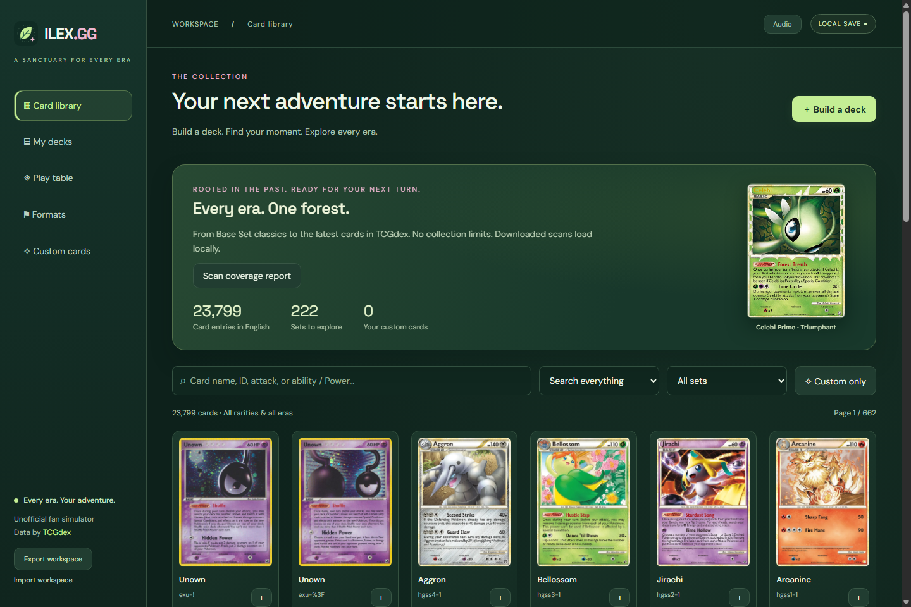
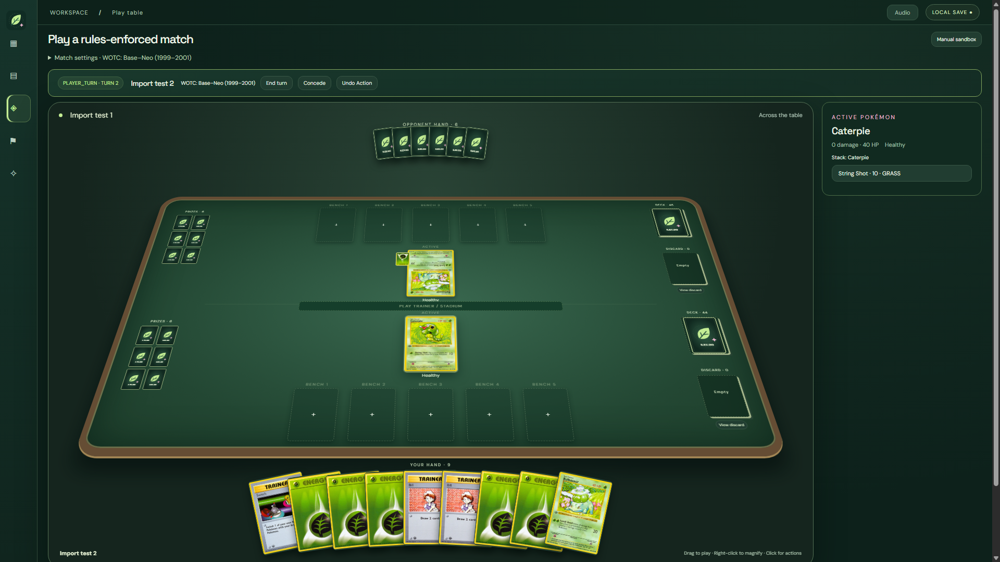
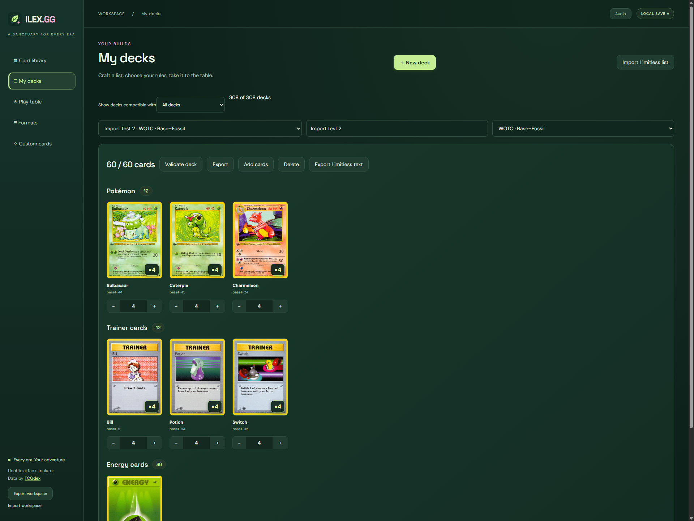

# ILEX.GG

Desktop Pokémon TCG simulator with deck building, custom cards, historical formats, a local play table, and rules automation.

## Watch the release trailer

[](https://www.youtube.com/watch?v=qoMEsEkn7J8)

[Watch on YouTube](https://www.youtube.com/watch?v=qoMEsEkn7J8) for EX-era gameplay, new features, and a preview of planned features before downloading.

ILEX.GG is still very much a work in progress, with more updates coming soon. Features labeled as planned in the trailer are not available yet.

## Screenshots

Screenshots from ILEX.GG 1.5.0.

### Main menu and card library



### Play table



### Visual deck builder



## Status

**The complete WOTC, EX, and Diamond & Pearl/Platinum eras are playable in ILEX.GG 1.6.0**, verified October 14, 2026.

- **WOTC:** Base Set through Skyridge, including Wizards Black Star Promos, Southern Islands, Legendary Collection, and Best of Game — **1,793/1,793 entries, zero pending**.
- **EX:** Ruby & Sapphire through Power Keepers, including the Unseen Forces Unown collection, EX Trainer Kits, Nintendo promos, and POP Series 1–3 — **1,857/1,857 entries, zero pending**.

- **Diamond & Pearl/Platinum:** Diamond & Pearl through Stormfront; Platinum through Arceus; all DP Black Star Promos; POP Series 4–9; both DP Trainer Kit halves; and Pokémon Rumble — **1,558/1,558 printings, zero pending**.

This release adds Lv.X inheritance, Pokémon SP, additive Weakness, Arceus deck exceptions, era-specific first-turn rules, and the era's Fossils, Tools, Technical Machines, Stadiums, and Special Energy. It preserves the WOTC/EX pool, current UI, image cache, music, format-first setup, Limitless integration, Undo, card search, visual decklists, and foil effects.

Fixes include cancelled choices and usage timing, copied Supporters and attacks, Premier Ball recovery, Darkness Grace evolution, Unown conversions, Energy Shift timing, Knock Out locks, Expert Belt prize timing, full-Bench attacks, and EX Dark Eyes resolution.

The authorized interaction scope is EX13–16 plus DP/Platinum. Full implementation coverage does not certify every possible interaction or ruling; Unlimited and unrelated era sweeps remain deferred.

## Download and play

Download [ILEX.GG-Windows.zip](https://github.com/KenGuyGames/ILEX.GG/releases/download/v1.6.0-build-2026-10-14/ILEX.GG-Windows.zip): **one ZIP, approximately 197 MiB**. Extract the entire ZIP, then launch `ILEX.GG.exe`. The runtime is included; Node.js and Python are not required.

Cards download automatically when viewed and are cached for offline use. Select **Download card images** at the bottom of the sidebar to download the full collection with pause/resume and retry. Allow about 2.5 GB of disk space for the full cache. Uncached cards need internet. The cache persists in `%APPDATA%\\TCG Lab\\card-cache` across app updates. Existing decks and workspace saves remain in use.

The source on `main` and the release's automatic source ZIP/tar.gz match this smaller build. The app files come from the release ZIP; rebuilding the synchronized rules source reproduces its engine SHA-256. See `verification/source-manifest-1.6.0.json`, `verification/desktop-verification-1.6.0.json`.

A fresh release-source download has now passed a clean Windows build and native startup test, including live artwork loading. See the fresh-install steps and test results below.

## Build and run from source

### Requirements

- A 64-bit Windows computer and Node.js 24 with npm. Git is optional if you download the source ZIP.
- Internet access for dependencies, the first Electron runtime download, and uncached card images.
- Disk space for the source, dependencies, and any card images you choose to cache.

Fresh-source build and startup verification ran on a clean `windows-2025` GitHub runner. Other operating systems have not been verified.

### Fresh install

Download **Source code (zip)** from the [1.6.0 release](https://github.com/KenGuyGames/ILEX.GG/releases/tag/v1.6.0-build-2026-10-14), extract it, and open PowerShell in the extracted folder containing `package.json`.

Alternatively, clone the release source:

```powershell
git clone --branch v1.6.0-build-2026-10-14 --depth 1 https://github.com/KenGuyGames/ILEX.GG.git
cd ILEX.GG
```

From that source folder, install and start the app:

```powershell
npm install
npm start
```

The first start downloads Electron if it is not already installed. Keep the terminal open while the app runs. No Python installation or copied scans folder is needed. Card images download as they are viewed and remain cached for offline use. Select **Download card images** in the sidebar for full offline caching; uncached images still need internet.

Existing scans in `outputs/Pokemon-TCG-Lab/scans` are used when present. Normal source launches use the existing `%APPDATA%\\TCG Lab` workspace, including saved decks and games.

### Rebuild the rules engine

The source includes a ready-to-run engine. To rebuild it from the checked-in TypeScript, install the locked build-tool dependencies and run:

```powershell
npm ci --prefix work/desktop-build
npm run build:rules
npm start
```

Run each command after the previous one finishes. The verified rebuild reproduces the engine SHA-256 recorded in `verification/source-manifest-1.6.0.json`. The card compilers and catalog generators are included for further development; they are not prerequisites for launching or rebuilding the checked-in app.

### Run the checks

From the source root:

```powershell
npm run test:rules
npm run test:ex
npm run test:dp
npm run test:bot
node work/desktop-build/card-cache-tests.cjs
```

The required WOTC audit, card-length, library-plan, and pending-card fixtures are included in the refreshed release source. If an older download reports a missing fixture, download the current release source again.

### Fresh-download test results

The [1.6.0 fresh-source verification workflow](https://github.com/KenGuyGames/ILEX.GG/actions/workflows/test-release-1.6.0.yml) downloads this release's source into a new folder and runs the README install, start, rebuild, and test commands on Windows with Node.js 24.

The matching packaged build passed the following recorded checks; see `verification/desktop-verification-1.6.0.json` and the validation JSON files under `work/desktop/validation`.

| Check | Result |
| --- | --- |
| Implemented printing coverage | WOTC 1,793; EX 1,857; DP/Platinum 1,558; zero pending |
| DP focused suite | 109 checks passed |
| Final printed-attack validation | 2,361 attacks across 1,384 Pokémon printings covered by smoke and isolated repair checks |
| Repair checks | 120 passing scenarios; intermediate discovery failures are preserved as audit evidence |
| Trainer audit | 266 resolved; 18 valid precondition rejections; zero unexpected failures |
| Power audit | 179 resolved; 183 unavailable in synthetic states; zero unexpected failures |
| Real-deck checks | Nine bounded 150-decision rollouts with replay/Undo; these are not nine completed games |
| Shared regressions | EX 170 focused checks; WOTC 68 checks plus 634 Base/Fossil and 2,510 WOTC scenarios; bot 17 checks/three completed starter games; Undo seven checks |
| Native desktop | Fresh/restored startup, coverage, Lv.X actions, hidden Energy, replay, Undo, and prior UI checks passed |
| Package integrity | 23,736 image hashes, 546 bundled source files, and archive CRCs verified |

Native release checks used test-only `--no-sandbox`/`--disable-gpu` flags; normal launches retain sandboxing. Runtime checks use isolated test profiles. This is build and smoke-test evidence, not certification of every card interaction. The fresh-source check does not download the entire artwork collection.

### Packaging notes

`package-dp.py` excludes scans by default; `--include-scans` creates an optional offline archive. Legacy packaging/install scripts expect the original output folders and native test profiles and are not a clean-clone release pipeline. Do not run `work/desktop-build/build.cjs` to update the current UI: it reconstructs an older base app.

## Credits and rights

Unofficial fan project. Pokémon names, card text and artwork belong to their respective owners. The rules engine includes modified Twinleaf code; its MIT notice is preserved in `work/desktop/ui/rules-engine-LICENSE.txt`. Card metadata originated from pokemon-tcg-data. No new license is granted for the original ILEX.GG code or third-party assets by this upload.


