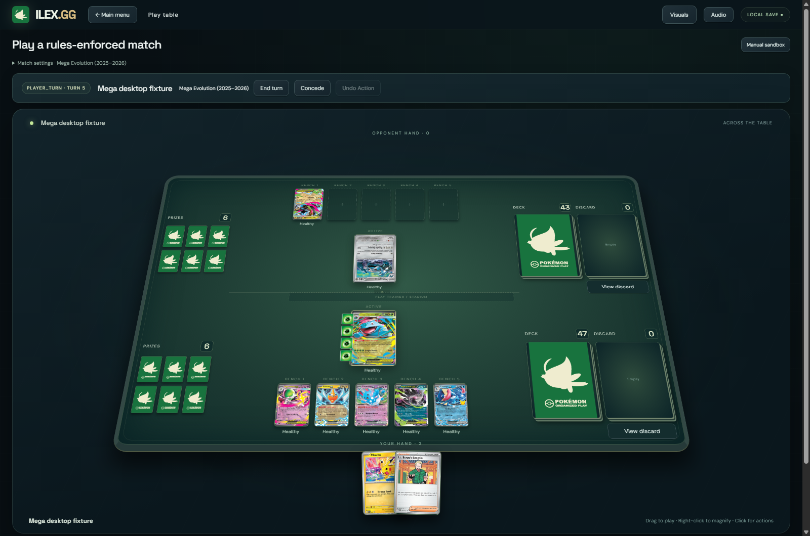
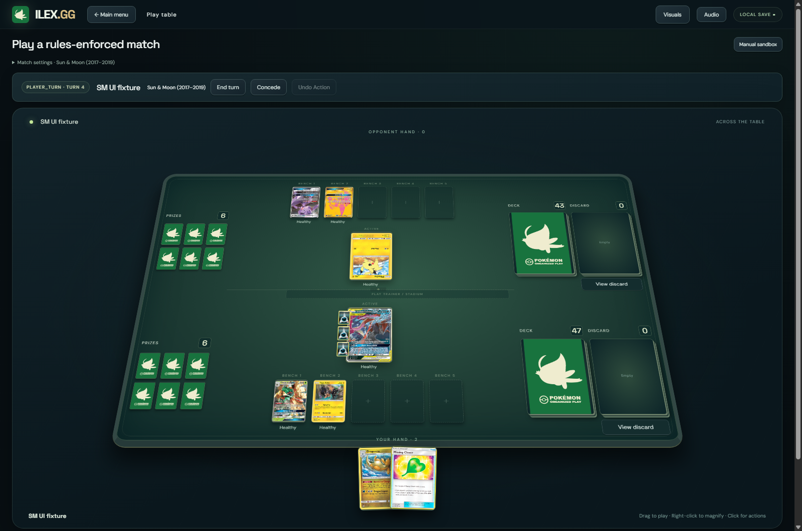
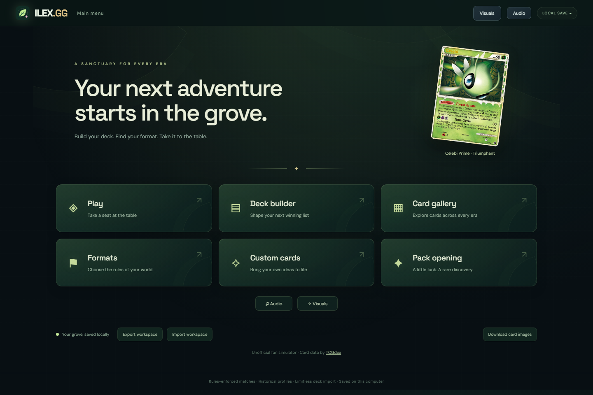
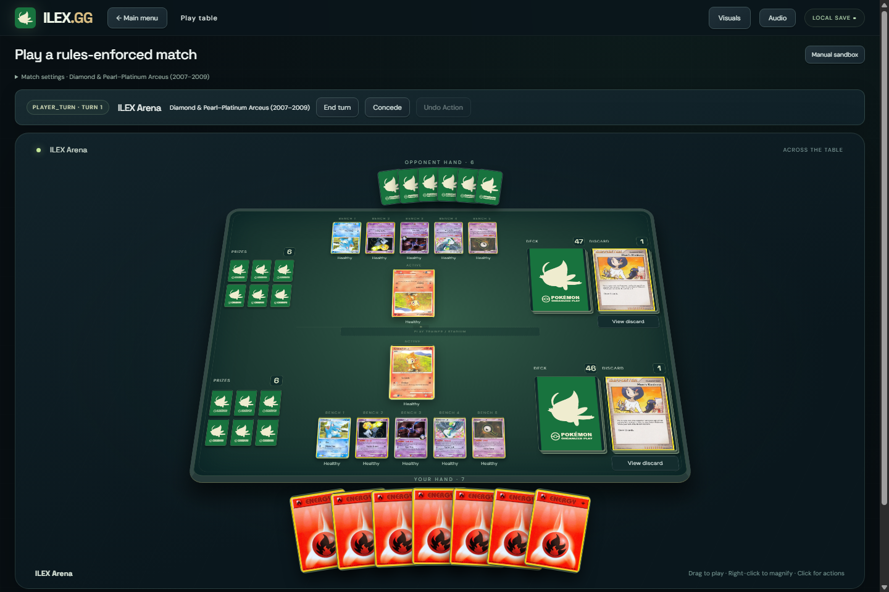
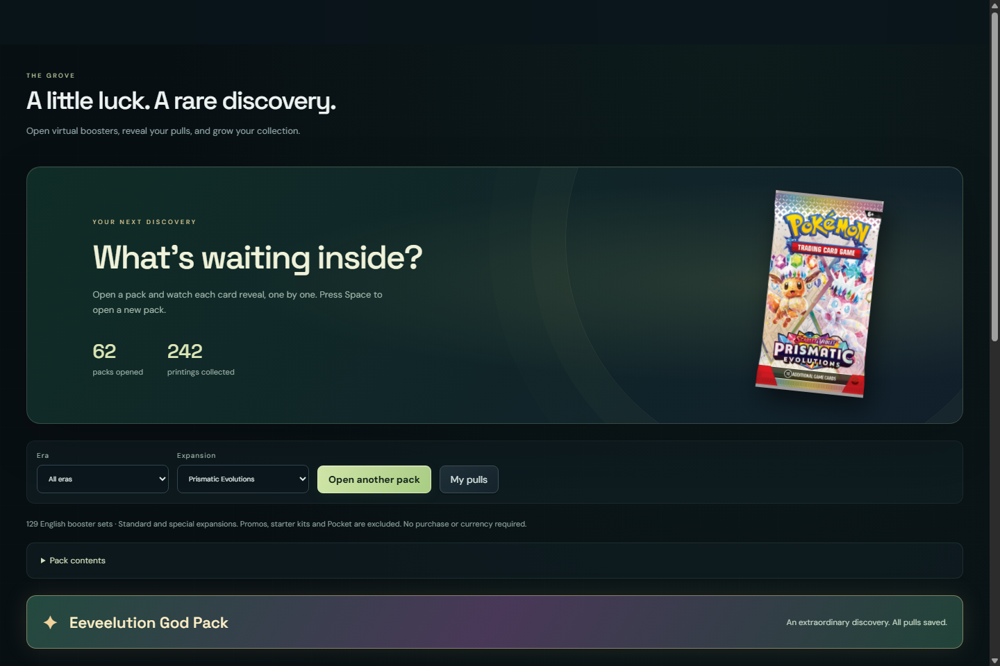
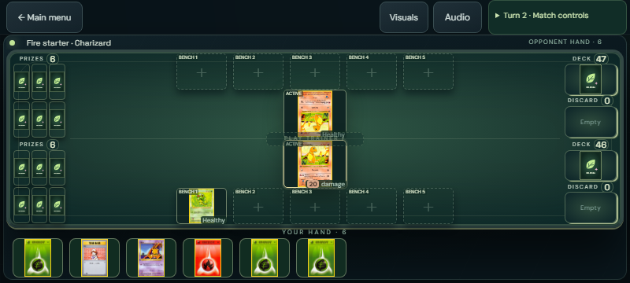
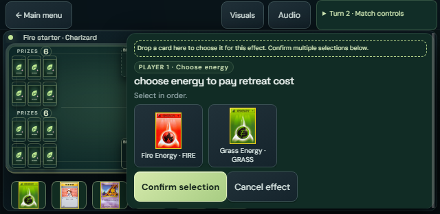

# ILEX.GG

Pokémon TCG simulator for **Windows and Android**, with historical rules automation, deck building, local/bot play, custom cards and pack opening.

## Download stable 1.19.0

| Platform | Download | Requirements |
| --- | --- | --- |
| Windows | [ILEX.GG-Windows.zip](https://github.com/KenGuyGames/ILEX.GG/releases/download/v1.19.0-build-2026-10-19/ILEX.GG-Windows.zip) — about 312 MiB | Windows 10/11 64-bit; extract the entire ZIP and run ILEX.GG.exe |
| Android | [ILEX.GG-Android.apk](https://github.com/KenGuyGames/ILEX.GG/releases/download/v1.19.0-build-2026-10-19/ILEX.GG-Android.apk) — about 135 MiB | Android 8+ with current WebView; 1.19.0-android.27 / versionCode 27 |

Windows includes its runtime. Android keeps the original signing certificate: install over the previous app to retain workspace/cache; export first if needed and do not uninstall. Physical Android device/emulator acceptance remains pending. This is a direct APK release.

Images download as viewed and remain cached. **Download card images** caches the full collection (about 2.5 GB), with pause/resume. Android bundles 439 verified startup/demo scans and 209 finish-specific images. Windows retains `%APPDATA%\TCG Lab`. Export/import transfers workspace JSON and replaces the destination workspace. There is no automatic cloud synchronization.

[Android installation](verification/ILEX.GG-Android-Install.md) · [Checksums and release evidence](https://github.com/KenGuyGames/ILEX.GG/releases/tag/v1.19.0-build-2026-10-19) · [Older releases](https://github.com/KenGuyGames/ILEX.GG/releases/)

## Multiplayer is now in beta

The stable Windows app retains the **Private multiplayer beta**: invite/response codes, legal decks and Ready confirmation, host-authoritative rules, filtered guest views, opponent-approved Undo, reconnect and separate hosted-match recovery. Both players must use the same 1.19.0 build.

**Real two-PC/Internet connectivity and a complete external match remain unverified.** Native two-window acceptance used simulated delivery. Direct WebRTC uses free STUN with no TURN relay; some networks may not connect. Play with trusted friends because the host can inspect full state. Android multiplayer, custom-card networking and public matchmaking remain deferred. Stable release status does not promote this feature out of beta.

[Invite, play and reconnect guide](verification/ILEX.GG-Private-Guide.md) · [Earlier separate 1.18.0 beta](https://github.com/KenGuyGames/ILEX.GG/releases/tag/v1.18.0-private.1-build-2026-10-19)

## New in stable 1.19.0

- **Complete Mega era through 30th Celebration: 1,293/1,293 standard-game printings, zero pending across ten catalogs.** MEE 16, Mega Evolution 188, MEP 110, Phantasmal Flames 130, Ascended Heroes 295, Perfect Order 124, Chaos Rising 122, Pitch Black 120, 30th 158 and Classic Collection 30.
- **MEP102–110 are nine officially announced anniversary previews**, with future release dates retained. Museum remains collection-only and unconfirmed RGB Mew cache rows are excluded. Classic Collection's historical mechanics do not establish tournament legality.
- Added modern Mega stage/Prize identities and reviewed Basic Energy names, physical attachment movement, damage/Weakness timing, reactive KO transfers/coins, optional Prize choices, Tool capacity/cleanup, Power Saver's condition, Gwynn's one-card discard, actual Antique Fossil identities, Waitress's selected Basic Energy and modern Antique setup restrictions.
- Fixed Windows display of the 22 new promo scans by using the already bundled, verified originals, with URL-field compatibility and official-host support; byte/hash verification and the source allowlist remain enforced.
- **22 additional exact scans**, bringing regular scan records to 23,860; 209 verified finish-specific images retained. Reverse-scan acquisition is still incomplete.
- **Android 1.19.0-android.27** includes the current Mega engine, updated mobile UI, 439 bundled startup/demo scans, original signing certificate and preserved workspace/cache.
- All earlier WOTC/EX/DP/HGSS/BW/XY/SM/SWSH/SV coverage, corrected UTF-8 comparisons, Psychic Embrace/Evosoda repairs, bots, packs, music, UI, saved formats and image caching remain available.

Interactions cover **Black & White onward through Mega**; historical profiles remain available and Unlimited is deferred. No newly maintained official Expanded banlist is included.

### Current release evidence

| Area | Recorded result |
| --- | --- |
| Mega identity and effects | 60 expected-result groups; 11,701 printed-field comparisons; 1,535 printed attack cases; 3,212 branch cases |
| Power / Trainer fixtures | 116 / 288 resolved; 300 / 86 conditional or passive fixtures explicitly unavailable |
| Mixed games | 24 bounded games, 2,111 decisions, 14 completed; exact replay/Undo |
| Shared / modern | 20 shared and 28 preserved modern groups; fresh/restored native desktop acceptance |
| Assets / Android | 23,860 regular scan hashes/decodes, 209 finish images; 140 mobile checks and three Mega landscape previews; APK CRC/signature/alignment checks |

These are finite checks, not proof of every board state. Unavailable fixtures are not passes. Current reports bind engine SHA-256 `dae9e59c8cedc6e7f40216556999a808e66800976bc0ec9569c54e109efd8722`; older reports retain their original hashes. Read `verification/desktop-verification-1.19.0.json`, `work/rules-research/mega-final-release-evidence.json`, `mega-source-validation.json`, `MEGA-PROGRESS.md` and `MEGA-RULES-SOURCES.md`.



## Earlier 1.18.0 beta changes

- **Multiplayer beta for Windows:** invite/response codes, legal deck/format checks, both-player readiness, filtered guest views, native card controls, opponent-approved Undo, reconnect and hosted-match recovery. Both players need the same beta build. Real network acceptance remains pending as described above.
- **Complete Sword & Shield:** 3,715/3,715 printings, zero pending across 28 catalogs, including all 307 promos, Sword & Shield through Crown Zenith, special expansions/subsets, Futsal and McDonald's 2021–22. Includes V-UNION composites and enlarged landscape actions.
- **Complete Scarlet & Violet:** 3,694/3,694 standard English TCG printings, zero pending across 20 catalogs, through Black Bolt/White Flare, special expansions, SVP001–225 and SVP500, McDonald's 2023–24 and SVE Energy. Battle Academy unique promos are included. My First Battle's separate simplified ruleset is excluded from standard 60-card automation.
- **Card repairs:** Custom Catcher's single/pair choices, Lysandre Labs' Tool suppression, Puzzle of Time with an empty deck and paired recovery, Shining Legends Pokémon Breeder's draw/heal effect, and Jamming Net/Head Ringer opponent targeting and original ownership. Evosoda now uses the actual first-turn window; Gardevoir ex Psychic Embrace accepts typed Psychic Energy, including the corrected SVE Basic Energy mappings, with damage/nonlethal restrictions retained.
- **Publication fix:** repaired UTF-8 source comparisons for EX Delta evolution and printed Pokémon/Power identities. The failing Dragon Frontiers Charmeleon → Charizard Peal of Thunder regression now passes; Windows and Android were rebuilt with this correction.
- **Table and packs:** GX/VSTAR used markers and new-match setup fixes; era-correct Basic Energy artwork, including the 30th Celebration MEE009–016 exception. Existing saved pulls are preserved.
- **209 verified finish-specific images:** 100 Legendary Collection reverses (original low-resolution watermarks retained) and 109 Prismatic Poké Ball/Master Ball images, with an Original finish images filter and source credits. Acquisition remains incomplete: 13,378 cataloged finish entries still lack verified images; other supported finishes use cosmetic reconstruction.
- **Updated Android:** same current card engine and local UI fixes, 395 bundled scans and 209 finish images. Android multiplayer is deferred. Earlier WOTC/EX/DP/HGSS/BW/XY/SM, bots, packs, music, image cache and UI remain available.

New interaction validation is scoped to **Black & White onward through Scarlet & Violet**; historical profiles remain available and Unlimited is deferred. No newly maintained official Expanded banlist is included. Modern pack contents do not imply automation beyond the implemented eras.

### Recorded validation and limits

| Area | Evidence |
| --- | --- |
| Multiplayer | 15 core checks, four simulated protocol checks, 20 native simulated two-window checks per launch; actual RTC connection and external PCs unverified |
| SWSH baseline | 67 expected-result checks, 4,869 printed attacks, 1,484 branch cases, 24 bounded games / 2,785 decisions with replay/Undo |
| SV baseline | 163 focused checks, 4,808 Pokémon attacks plus six TM attacks, 7,312 branch cases, 24 bounded games / 2,161 decisions with replay/Undo |
| Latest engine fixes | 24 Evosoda and 72 Psychic Embrace focused checks; genuine replay/Undo and native fresh/restored checks recorded |
| Android | 128 mobile Chromium and 38 package checks recorded for Psychic Embrace; original certificate retained; physical-device acceptance pending |
| Assets | 23,838 scan records and 209 verified finish-specific images retained |

The broad SWSH/SV baseline reports retain their original engine hashes. The beta and Android use the publication encoding repair engine `d7bf35e686eb84cdb9746be6b9cbfbad5c65f4f96e5644b37e68fae465b524a7`; historical broad results have not been relabeled as new-hash passes. Finite fixtures and bounded games do not prove all possible interactions. See `verification/ILEX.GG-Private-verification.json`, `work/rules-research/private-preview-release.json`, `sv-source-validation.json`, `swsh-source-validation.json`, `evosoda-fix.json` and `psychic-embrace-fix.json`.

## Earlier 1.15.0 changes (historical release notes)

### Complete XY and Sun & Moon eras

- **XY: 2,208/2,208 printings, zero pending** — Kalos Starter, XY through Evolutions, 216 catalog XY promos, six Yellow A alternates, Double Crisis, Generations/Radiant Collection, eight 30-card Trainer Kit decks and McDonald's 2014–16.
- **Sun & Moon: 3,069/3,069 printings, zero pending across 23 catalogs** — SM through Cosmic Eclipse, Shining Legends, Dragon Majesty, Hidden Fates/Shiny Vault, Detective Pikachu, SM1–SM248 promos and SM30a/103a/104a, McDonald's 2017–19, both complete 30-position Trainer Kits and omitted alternate printings.
- Added era profiles and reviewed Mega/Primal Evolution, Fairy typing, Ancient Traits, BREAK, GX/TAG TEAM, Prism Star, Ultra Beast and Z-Move Tool interactions. Historical formats and prior WOTC/EX/DP/HGSS/BW coverage are preserved.
- New interaction validation is scoped to **Black & White onward through implemented Sun & Moon**. Unlimited, later-era automation, networking and a new official Expanded banlist remain deferred. Modern pack contents do not imply later-era automation.
- Added **68 exact scans**, bringing the manifest to **23,804**. Twelve numbered Trainer Kit Energy originals are only 253×359; they are retained at their real resolution.

### Realistic Player bot

A separate **Realistic Player** option joins Easy, Normal and Hard. Local deterministic bounded search plans up to three actions, rechecks leading actions against a second concealed forecast, and considers search/discard/gust/acceleration choices, follow-up attackers, Prize exposure, excess Energy, Bench liabilities and deck-out. Combo support includes Night March/Vengeance/Bee Revenge.

Planning runs in an offline worker. Pause, Undo, difficulty changes and backgrounding cancel it; stale match/journal/table results cannot commit. Actual actions still use the existing rules reducer and forecast animations/audio remain quiet. Research used first-person tournament reports and official competitive analysis; this is not imitation training or proof of professional strength or a win-rate advantage over Hard.

### Gameplay and presentation repairs

- Corrected Basic Darkness/Metal Energy so the older Special Energy bonus/self-damage reducers apply only to explicitly Special printings; 44 targeted checks retain old Special Energy behavior.
- XY fixes cover Pyroar Flare Command costs/targets, Venipede's printing stats, Delta Evolution eligibility, Dry Skin and named Yveltal conditions, Cross Slicer/Time Freeze protection, Burning Energy recovery, attached-Energy zones/ownership, Stardust shields, native attack indexes, Mist Slash/Recoil and defensive Energy discards after damage.
- SM fixes cover attack continuation and empty-slot checks; scoped GX permissions without erasing shared history; Z-Move Tool dispatch; KO timing/history; Cat Walk/Dance of Tribute usage limits; Energy selection/transfer; conditional and named Powers; and Perfection/Time Recall copying eligibility.
- Town Map's revealed holo Prizes now stay positioned inside their pile on desktop and Android. Grass impact progress is clamped, and animation exceptions/lost frames release gameplay; Skip remains available.
- Printed attacks and Powers use transparent, outlined, full-height action regions. Accessible names/tooltips remain; copied actions, Retreat and no-scan fallbacks retain named buttons. Reviewed boundaries and joined LEGEND geometry are preserved.
- A flat green/ivory Celebi sleeve recreation is shared by hidden hands, decks, Prizes and pack backs. Its silhouette is also used by Windows/Android icons and coin faces: cream-on-green heads, green-on-cream tails. Engine coin outcomes are unchanged. Attribution and approximation limits are recorded in `work/desktop/ui/CARD-BACK-SOURCE.md`.
- Pack auto-reveal is now **450 ms**; sequential reveal, pause, Space, persistence and privacy are preserved.

### Updated Android

**1.15.0-android.14 / versionCode 14** keeps the original signing certificate. Install over the existing app to retain its workspace and cache. It includes the current SM/XY engine, Realistic Player worker, presentation fixes and landscape touch UI. **246 verified startup/Base–Fossil/SM demonstration scans** are bundled.

65 mobile checks, SM checks at three landscape sizes, 30 APK/static checks, and official SDK signature/alignment verification pass. **Physical Android device/emulator acceptance remains pending**, including native pickers, live cache downloads, lifecycle/audio and performance. This is a direct APK release, not Play Store publication.

### Current release evidence

| Area | Recorded result |
| --- | --- |
| SM | 82 expected-result checks; 4,387 Pokémon attacks plus three Z-Move Tool attacks; 1,168 branch cases; Ability/Trainer and identity audits |
| Scoped SM decks | 24 bounded games, 2,774 decisions, exact replay/Undo; not 24 claimed completed games |
| XY | 52 original focused checks plus 56 interaction cases; 2,787 Pokémon attacks plus two Tool attacks; 1,604 branch cases; printed-data/identity audits |
| Realistic Player | 18 tactical/privacy checks, shared bot groups with four completed starter games, eight bounded BW/XY games; 12 native worker checks per launch and 13 Android worker checks |
| Shared/native | 13 shared suites and desktop v8 fresh/restored, retaining historical formats, packs, LEGEND, UI/audio, bot and Undo |
| Integrity | 23,804 scan hashes, 5,269 provenance files, Windows archive integrity, matching Windows/Android engine and signed APK checks |

See `verification/desktop-verification-1.15.0.json`, `work/rules-research/sm-final-release-evidence.json`, `sm-source-validation.json`, `SM-PROGRESS.md`, `SM-RULES-SOURCES.md`, `xy-interaction-release.json` and `realistic-bot-release.json`. Failed/intermediate reports remain historical evidence. Finite fixtures and bounded rollouts do not prove every possible board state.



## Earlier features retained (through 1.12.0)

This release includes the locally completed 1.7.0–1.12.0 updates and the subsequent UI, pack, and Android improvements.

### Complete HGSS and Black & White eras

- **HGSS / Call of Legends: 605/605 printings, zero pending.** HeartGold SoulSilver, Unleashed, Undaunted, Triumphant, Call of Legends, all 25 HGSS Black Star Promos, and both HS Trainer Kits.
- **Black & White: 1,521/1,521 printings, zero pending.** BW through Legendary Treasures, Dragon Vault, all BW01–BW101 catalog promo entries, both BW Trainer Kits, and the McDonald's 2011/2012 collections.
- Added LEGEND-pair assembly and rules, Prime cards, Lost Zone interactions, BW Abilities, Pokémon-EX, Dragon typing, Team Plasma membership, ACE SPEC and relevant era mechanics.
- All nine assembled LEGEND pairs display as one upright joined card on the table, in enlarged actions and magnification. Individual halves remain individual cards, and hidden cards stay hidden.
- WOTC **1,793/1,793**, EX **1,857/1,857**, and DP/Platinum **1,558/1,558** coverage remains available with zero pending.

Those are the historical baseline scopes for these earlier releases. Current new-work validation uses BW onward through SM as described above; older rule profiles and regressions remain available. Unlimited and online multiplayer remain deferred.

### Redesigned desktop and main menu

- Forest, obsidian and gold presentation with a full-width match table, larger Deck/Discard/Prize piles, elemental attack effects, actual damage feedback, real engine-result coin flips, and Knock Out/Prize/victory feedback.
- Saved Visuals controls for effects, speed and impact motion; Skip/Escape and system reduced-motion support. Rejected moves, forecasts and replay stay quiet, and bot dispatch waits for presentation.
- Dedicated forest home screen with Play, Deck builder, Card gallery, Formats, Custom cards and Pack opening. Audio/Visuals, workspace transfer and card-image downloads are accessible from home.
- Celebi Prime appears first at launch; eight curated Celebi printings rotate on returns to the menu, without advancing on ordinary redraws.
- Decks group Pokémon by evolution lineage and copies; Trainers sort by Supporter, Item, Tool/Technical Machine and Stadium, followed by Basic/Special Energy. Saved deck order, quantities and exports are preserved.
- Indexed catalog lookups and format-compatibility caching greatly reduce deck-filter work. The recorded 306-deck benchmark reduced cold renderer filtering from about 13.4 seconds to 37.9 milliseconds; this does not measure network/image latency.

### Pack opening and collection

- **129 English pack profiles** with actual bundled booster-wrapper artwork, era/set selection, ordinary slots, chase slots and supported special-expansion structures.
- Sequential automatic reveals at 450 ms, rare-pull shine and chase glow, reveal/pause controls, Space to open one new pack, magnification and reduced-motion support. Navigation, dialogs and backgrounding pause reveals.
- A separate **My pulls** collection with quantities by finish, pagination, parent-era filtering and persistent partly revealed packs. Packs commit once before revealing; reloads resume rather than reroll, and save failures roll back.
- **705 subset printings across 18 groups** are reachable within parent packs, including Shiny Vaults, Galarian/Trainer Galleries, Radiant collections, Paldean Fates shinies, Celebrations/30th Classics, Unseen Forces Unown and numbered DP/Platinum subsets.
- Reverse Holo finishes and **505 supported Poké Ball/Master Ball variants** across Prismatic Evolutions, Black Bolt, White Flare and eligible Ascended Heroes printings.
- Ascended Heroes has **318 reverse variants**, including Friend/Love/Quick/Dusk Ball, type-specific Energy symbols and Team Rocket patterns. Unsupported Master Balls and generic Pokémon reverse variants are excluded.
- **Six rare English god/demigod layouts across five expansions:** 151 starter-line demigod, Prismatic Eeveelution god and triple-SIR demigod, Black Bolt/White Flare art layouts, and Ascended Heroes Mega layout. Special layouts roll once, preserve hidden identities, and celebrate only after the final reveal. Japanese-only layouts and unsupported sets are excluded.
- 30th Classic Collection's 30 printings can appear inside the parent anniversary packs; its six-card structure, guaranteed Pikachu and foil Energy are retained.

Pack collation and rare-layout frequencies are simulation estimates where physical rates are unpublished. Reverse and ball patterns are **cosmetic reconstructions over base scans**, not separate scans of every finish. Existing saved pulls are preserved. Detailed sources and limits are in [PACK-SOURCES.md](work/desktop/ui/PACK-SOURCES.md).

### Android with touch controls and a landscape table

- Tap a field Pokémon for attacks, Powers and Retreat; hold a revealed card to magnify it.
- Tap a hand card and choose **Place on table**, then a highlighted destination, or drag it onto the table. Swipe horizontally through a large hand.
- A dedicated landscape arena keeps **both fields, both Benches, all piles and your hand on one screen**. Match controls, new-match settings, log, sandbox and effect choices use overlays. Ordinary Energy choices and Confirm fit at small landscape heights; large choice pools can scroll inside their controls.
- Portrait retains its scrolling layout. Touch cancellation, stale-state guards, multitouch cancellation and duplicate-click suppression preserve reducer/journal/Undo behavior.
- Android Back dismisses overlays or returns home; workspace export/import uses native file pickers. Rotation retains the app, and backgrounding pauses bot/audio/timers and bulk image downloads without changing saved preferences.
- Only INTERNET is requested; broad storage permission is not required. Downloaded artwork is size/hash checked before caching.

**Android validation limits:** 59 Chromium mobile/touch checks and 28 package/static checks passed, along with official APK v2/v3 signature and alignment verification. Landscape layouts were checked at five sizes down to 640×312. **No physical Android device or Android emulator installation has been tested.** Native file pickers, real-device cache downloads, lifecycle/audio and performance still need installed-device acceptance. Touch tests mock the native bridge; this is not device certification.

### Gameplay and reliability fixes since 1.6.0

- Full-Bench searches and placement effects finish correctly for reviewed HGSS/BW cards; typed searches and required public selections retain their restrictions.
- Rescue Energy timing and owner ordering, Lost Burn physical-card costs, Ho-Oh LEGEND conversion, copied HGSS/BW Supporters, Lost Link exclusions, and zero Retreat/Insight precedence have focused regressions.
- Flexible Blend Energy and Double Colorless Energy now use shared **provided Energy units** in affected BW/HGSS attacks and bot scoring.
- First Ticket resolves simultaneous private pregame choices correctly. Mew-EX Versatile inherits eligible attacks without donors' Powers; older Pokémon-ex and BW Pokémon-EX identities remain distinct.
- Team Plasma Badge membership updates across zones and is removed when its Tool leaves. Hand/discard Abilities have validated controls, bot candidates, stale-view/opponent-action guards and normal Undo.
- Corrected constrained counter movement, bot counter caps, private seeded Rock Paper Scissors, G Booster/shred bypass and costs, and G Scope targeting.
- Added scoped height metadata and printed feet/inches handling for Cedric; unresolved printings remain ineligible rather than guessed.
- Fixed subset collection-era filtering, reveal/reload rerolls, finish identity, reduced-motion/stale overlay cleanup, catalog/format-cache invalidation and deck redraw performance.

## Screenshots

Current desktop and Android layouts (Android captures use Chromium touch emulation):

### Forest main menu



### Play table



### Pack opening



### Android landscape





## Build and run the Windows source

Requires 64-bit Windows and **Node.js 24 with npm**, plus internet for dependencies and uncached artwork. Other desktop operating systems are not verified.

Download **Source code (zip)** from the [stable 1.19.0 release](https://github.com/KenGuyGames/ILEX.GG/releases/tag/v1.19.0-build-2026-10-19), extract it, and open PowerShell in the folder containing package.json. Or clone:

```powershell
git clone --branch v1.19.0-build-2026-10-19 --depth 1 https://github.com/KenGuyGames/ILEX.GG.git
cd ILEX.GG
npm install
npm start
```

Keep the terminal open while playing. Normal launches use the existing Windows workspace; export it before source experiments. The ready-to-run engine is included. Python and a copied scan folder are not needed to launch.

Rebuild and launch:

```powershell
npm ci --prefix work/desktop-build
npm run build:rules
npm start
```

The build wrapper selects the **canonical corrected UTF-8 TypeScript in work/mega-source/src**. It does not use the older shared source tree. The rebuilt engine must match SHA-256 `dae9e59c8cedc6e7f40216556999a808e66800976bc0ec9569c54e109efd8722`, recorded in `verification/source-manifest-1.19.0.json`. Do not rerun initial card generators over this release.

Run checks sequentially:

```powershell
npm run test:rules
npm run test:ex
npm run test:dp
npm run test:hgss
npm run test:bw
npm run test:xy
npm run test:sm
npm run test:swsh
npm run test:mega
npm run test:evosoda
npm run test:psychic
npm run test:multiplayer
npm run test:protocol
npm run test:realistic
npm run test:bot
node work/desktop-build/card-cache-tests.cjs
```

`test:rules` is the focused shared WOTC suite. Multiplayer/protocol tests simulate delivery and do not establish real connectivity. Fresh-source install/start/rebuild/tests and both automatic source archives are checked by the [stable source workflow](https://github.com/KenGuyGames/ILEX.GG/actions/workflows/test-release-1.19.0.yml).

### Retained 1.12.0 baseline verification

| Area | Evidence |
| --- | --- |
| BW | 66 focused checks; all 2,206 printed Pokémon attacks plus two Tool attacks; 5,196 branch cases; Power/Trainer audits |
| Scoped BW decks | 18 bounded rollouts, 1,596 decisions, exact replay/Undo; not 18 claimed completed games |
| Shared regressions | HGSS 32, DP 109, EX 170, focused WOTC 127, bot 17 including three complete starter games, Undo seven |
| Desktop | Fresh/restored native checks for gameplay, presentation, menu, deck sorting/performance, all nine LEGEND pairs, packs and persistence |
| Packs | 303 ordinary checks; 705 subset, 505 ball and 318 Ascended-pattern reachability cases; 500,000 production-generator samples for six special layouts |
| Package | 23,736 scan hashes, 1,941 bundled provenance files, Windows archive integrity and engine/source consistency |
| Android | 59 emulated touch/layout checks, 28 package/static checks, APK CRCs, official signatures and alignment; device acceptance pending |

Reports are included in `verification/desktop-verification-1.15.0.json`, `verification/ILEX.GG-Android-verification.json`, `work/android-build/mobile-verification.json` and `work/rules-research`. Earlier and failed discovery reports are retained as historical evidence; they are not relabeled as final passes. Finite tests do not prove every board state.

Recorded native desktop release checks used isolated profiles and test-only no-sandbox/disable-gpu flags required by that environment. Normal launches retain the Chromium sandbox. A full live download of every image is not part of fresh-source verification.

### Android source and packaging

Android source and rebuild notes are in [work/android-build/README.md](work/android-build/README.md). Rebuilding requires JDK 17, the verified official Android SDK tools and Python; it is separate from the Windows Node.js instructions. The original signing key and password are deliberately excluded. A build signed with a different key cannot update the installed release in place.

`package-mega.py` and `finish-mega.cjs` package this stable release. Packaging scripts expect original candidate/output folders and native profiles; they are not a clean-clone release pipeline. Do not use the legacy `work/desktop-build/build.cjs` to regenerate the current UI.

## Earlier release trailer

[](https://www.youtube.com/watch?v=qoMEsEkn7J8)

[Watch on YouTube](https://www.youtube.com/watch?v=qoMEsEkn7J8). This is the earlier EX-era trailer, not a demonstration of every current feature. Planned features in it are not promises of availability. ILEX.GG remains a work in progress.

## Credits and rights

Unofficial fan project. Pokémon names, card text and artwork belong to their respective owners. Modified Twinleaf rules-engine code retains its MIT notice at `work/desktop/ui/rules-engine-LICENSE.txt`. Card metadata originated from pokemon-tcg-data; booster artwork sources are documented in PACK-SOURCES.md. No new license is granted for original ILEX.GG code or third-party assets by this upload.
